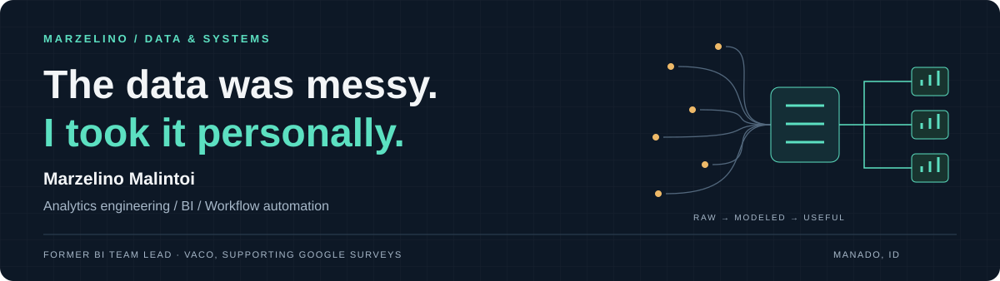
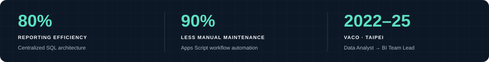
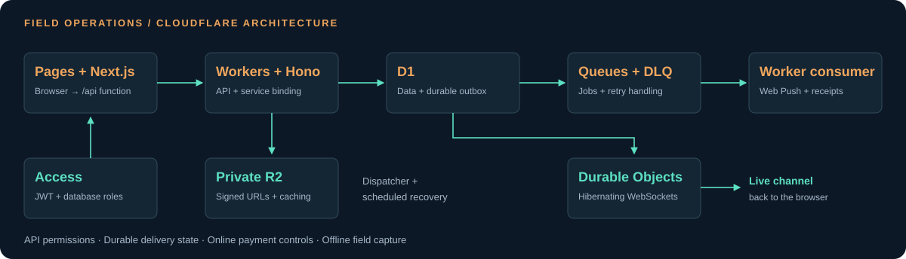
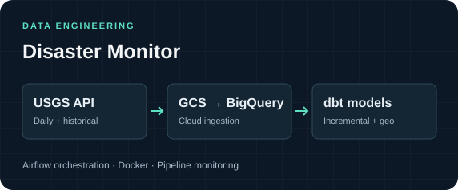
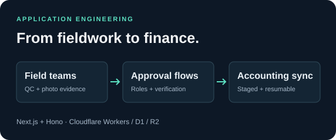
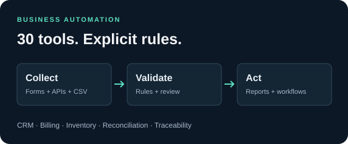
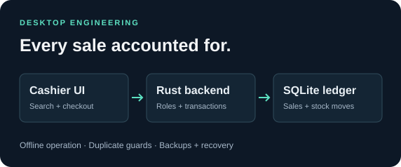
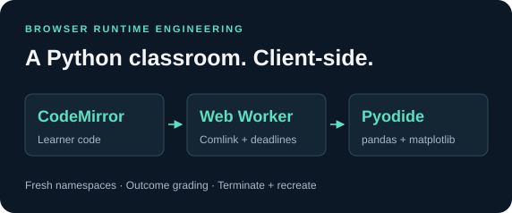

  

### Analytics Engineer · Cloud Applications & Automation

**From data models to the software people use to act on them.**

📍 Manado, Indonesia · Open to opportunities & project collaborations

## 🧭 From the numbers to the workflow

I’m **Marzelino**, an analytics engineer and former **BI Team Lead at VACO, supporting Google Surveys in Taipei**. My work connects three things: **reliable data, useful reporting, and the business processes behind them**.

I work across **SQL/dbt pipelines, Power BI, and full-stack TypeScript applications on Cloudflare**. My projects include real-time field operations, accounting integrations, an offline Windows POS, and a **30-project Google Workspace portfolio** with resumable ETL and recoverable business workflows.

I design for the day the connection drops, the request repeats, or the numbers need explaining. An **MBA and a Chemical Engineering background** help me connect the business process to the implementation.

  

## ☁️ Cloudflare, beyond hosting

**Hibernating WebSockets. Queue retries and dead-letter handling. Private media. Encrypted OAuth tokens.** These are implemented parts of my construction operations platform.

**[Inside the notification architecture →](docs/engineering-notes.md#cloudflare-real-time-delivery-with-a-durable-backbone)** · **[Accounting sync & encrypted OAuth →](docs/engineering-notes.md#construction-operations-connecting-field-evidence-to-payments)**

## 🚀 Selected systems & analytical work

<table>
<tr>
<td width="50%" valign="top">

<h3>📊 Olist Executive Dashboard</h3>

<strong>A business story across sales, delivery, and satisfaction.</strong> Four report pages connect executive KPIs with revenue risk, delivery performance, and reviews. A versioned semantic model combines star-schema relationships, time intelligence, and dynamic DAX callouts.

  

<a href="https://github.com/marzelino10/olist-executive-dashboard"><strong>Code ↗</strong></a> · <a href="https://github.com/marzelino10/olist-executive-dashboard/blob/main/Olist%20Executive%20Dashboard.SemanticModel/definition/tables/_Measures.tmdl">DAX source ↗</a> · <a href="https://marzelino10.github.io/olist-executive-dashboard/">Preview ↗</a>

</td>
<td width="50%" valign="top">

<h3>🏔️ Global Ski Resorts Pipeline</h3>

<strong>From raw files to analysis-ready models.</strong> Bronze → Silver → Gold models turn source files into resort suitability scores and snow-coverage analysis. Includes a 30 km spatial join, weighted scoring logic, and dbt quality checks.

  

<a href="https://github.com/marzelino10/ski-resorts"><strong>Code ↗</strong></a> · <a href="https://github.com/marzelino10/ski-resorts/blob/main/ski_resorts_pipeline/models/gold/gold_beginner_expert_resort.sql">Scoring SQL ↗</a> · <a href="https://marzelino10.github.io/ski-resorts/">Docs ↗</a>

</td>
</tr>
<tr>
<td width="50%" valign="top">

<h3>🌋 Disaster Monitor</h3>

<strong>Earthquake data with a traceable path to analytics.</strong> Daily USGS ingestion and mapped historical backfills feed update-aware incremental merges and geospatial country enrichment. Run statistics, retry policies, and Slack alerts expose pipeline health.

   

<a href="docs/engineering-notes.md#disaster-monitor"><strong>Pipeline decisions ↗</strong></a>

</td>
<td width="50%" valign="top">

<h3>🏗️ Construction Operations PWA</h3>

<strong>Software that follows the work on site.</strong> QC evidence connects to purchasing, inventory, and contractor payments. Access JWT validation and D1 roles enforce permissions; IndexedDB preserves field submissions; resumable OAuth2 accounting sync publishes complete stock snapshots.

  

<a href="docs/engineering-notes.md#construction-operations-connecting-field-evidence-to-payments"><strong>Engineering decisions ↗</strong></a>

</td>
</tr>
<tr>
<td width="50%" valign="top">

<h3>⚙️ Google Workspace Systems</h3>

<strong>30 standalone portfolio projects around real business workflows.</strong> Across the portfolio: resumable ETL, field-level transformation history, lot genealogy, budget controls, revision-aware approvals, and queued Workspace integrations. Interrupted multi-sheet commands recover from persisted plans.

  

<a href="docs/engineering-notes.md#google-workspace-small-systems-with-explicit-business-rules"><strong>Systems & validation ↗</strong></a> · <a href="https://github.com/marzelino10/label-generator">Public example ↗</a>

</td>
<td width="50%" valign="top">

<h3>🧾 Offline Retail POS</h3>

<strong>Keep selling without the internet.</strong> Repeated payment requests return the original receipt. Rust/SQLite transactions own prices and stock; an append-only ledger supports reconstruction. Cross-built Windows installers include backups, migrations, and scrubbed support bundles.

  

<a href="docs/engineering-notes.md#offline-retail-make-every-sale-and-stock-movement-explainable"><strong>Transaction & inventory design ↗</strong></a>

</td>
</tr>
</table>

## 🧪 More engineering worth a look

<table>
<tr>
<td width="50%" valign="top">

<h3>🐍 Python classroom. No Python server.</h3>

Real pandas and matplotlib run in a Pyodide/WebAssembly worker. A runaway program is terminated and the interpreter is recreated; each run gets a fresh namespace. Outcome-based grading accepts different correct solutions.

<strong>React · TypeScript · CodeMirror · Comlink · Pyodide · Cloudflare Workers Static Assets</strong>

<a href="docs/engineering-notes.md#browser-python-execution-without-a-python-server"><strong>Runtime & recovery design ↗</strong></a>

</td>
<td width="50%" valign="top">

<h3>💬 Search by meaning, not keywords.</h3>

<a href="https://github.com/marzelino10/moody-quotes"><strong>Moody Quotes</strong></a> connects collected quotes, PostgreSQL/Supabase, sentence embeddings, and cosine similarity in Streamlit. A separate local document-Q&A experiment adds PDF chunking, Ollama, LangChain, and Chroma retrieval.

<strong>Python · Sentence Transformers · PostgreSQL · Supabase · Streamlit</strong>

<a href="https://github.com/marzelino10/moody-quotes/blob/main/app.py"><strong>Semantic search implementation ↗</strong></a>

</td>
</tr>
</table>

**Beyond the dashboard:** I’ve also built a **Canvas 2D isometric portfolio** with playable interiors and furniture-aware routing; **Kotlin/Compose games** with a custom low-poly renderer and vocabulary-review logic; and **Astro sites** with Sharp-generated AVIF/WebP images and automated publishing checks.

**[Explore these implementations →](docs/engineering-notes.md#interactive-products-and-delivery)** · [FIFA World Cup SQL](https://github.com/marzelino10/projectFIFA) · [Selenium football scraper](https://github.com/marzelino10/WhoScored_Selenium)

## 🛠️ Technologies used in my projects

**Languages**

      

**Data engineering & storage**

         

**Cloudflare platform**

       

**Full-stack web & APIs**

       

**Analytics & Workspace automation**

          

**Applied AI & browser runtimes**

       

**Native, interactive & delivery**

         

**Architecture & integration patterns:** REST APIs · OAuth2 · JWT/JWKS · RBAC · WebSockets · Web Push · Service Workers · IndexedDB · command journals · outbox delivery · data lineage · geospatial SQL.

## 💼 The experience behind the builds

**VACO · Supporting Google Surveys · Taipei, Taiwan**

🟢 **BI Team Lead** · *2024–2025*

- Led BI work across data engineering, analytics, knowledge architecture, and innovation.
- Centralized historical utilization reporting in SQL, improving reporting efficiency by **80%**.
- Automated brand-safety workflows with Apps Script, reducing manual maintenance by **90%**.
- Mentored analysts in SQL, Looker Studio, and Apps Script.

🔵 **Data Analyst** · *2022–2024*

- Standardized data integration and reporting workflows across international teams.
- Automated recurring business reports with SQL, Google Sheets, and Apps Script.

---

### 🤝 Got a messy data problem? Let’s talk.

For **analytics engineering, BI, and business automation** opportunities, 
I bring the reporting background and the engineering to build what comes next.

**[Connect on LinkedIn ↗](https://www.linkedin.com/in/marzelino/) · [Send me an email ↗](mailto:marzelino.malintoi@gmail.com)**

Built around the work. Backed by the details.

