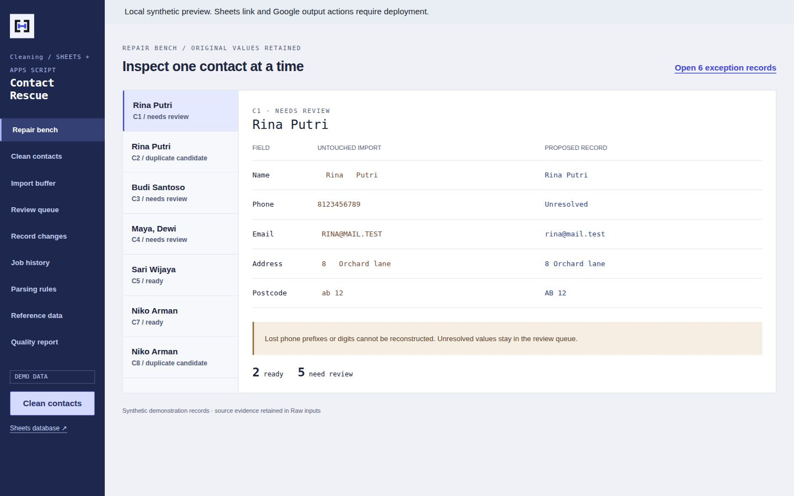
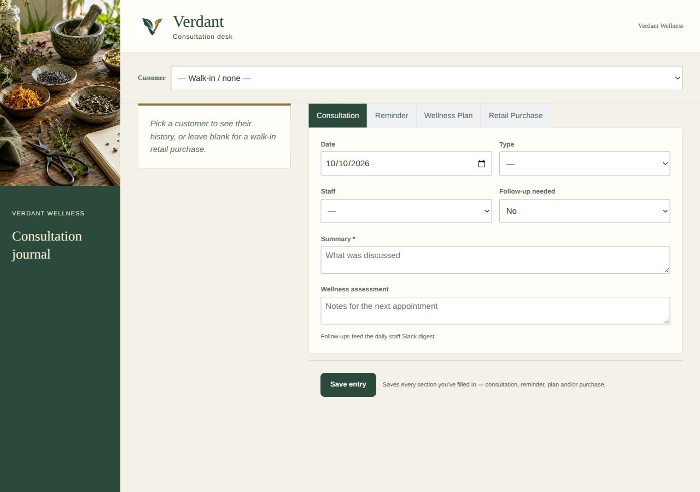

# Marzelino Malintoi

### Data & Automation Engineer

*The data was messy. I took it personally.*

I build **data pipelines, reporting, and automation** that help teams trust their numbers and keep work moving. Previously, I led BI work at **VACO, supporting Google Surveys in Taipei**. My background combines an MBA with Chemical Engineering.

<table>
<tr>
<td width="50%" align="center"><h2>80%</h2>
Improvement in reporting efficiency Centralized SQL reporting at VACO
</td>
<td width="50%" align="center"><h2>90%</h2>
Less manual maintenance Apps Script workflow automation at VACO
</td>
</tr>
</table>

## Selected work

<table>
<tr>
<td width="50%" valign="top">

<h3>Olist Executive Dashboard</h3>

<strong>See where revenue and delivery performance need attention.</strong> Four report pages connect executive KPIs with product categories, regions, delivery delays, and customer reviews.

  

<a href="https://github.com/marzelino10/olist-executive-dashboard"><strong>Repository ↗</strong></a> · <a href="https://marzelino10.github.io/olist-executive-dashboard/">Dashboard preview ↗</a>

</td>
<td width="50%" valign="top">

<h3>Global Ski Resorts Pipeline</h3>

<strong>Compare resorts using analysis-ready data.</strong> Layered models join resort and snow observations, score skier suitability, and check data quality.

  

<a href="https://github.com/marzelino10/ski-resorts"><strong>Repository ↗</strong></a> · <a href="https://marzelino10.github.io/ski-resorts/">Models & documentation ↗</a>

</td>
</tr>
<tr>
<td width="50%" valign="top">
<h3>Kairagi PWA</h3>

<strong>Connect field progress to purchasing and payments.</strong> Construction QC, photo evidence, material workflows, and contractor payments share one operational system.

Offline capture keeps field work moving. Controlled access, private media, recoverable accounting syncs, and reliable notifications support the review process.

     

Application tools: TypeScript, Next.js, Hono, OAuth2

</td>
<td width="50%" valign="top">
<h3>Disaster Monitor</h3>

<strong>Turn earthquake records into country-enriched analytics.</strong> Daily USGS ingestion and historical backfills feed incremental models and geospatial enrichment.

Run statistics, retry policies, and Slack alerts make failed runs visible and support recovery.

   

Storage: Google Cloud Storage. Orchestration: Airflow in Docker.

</td>
</tr>
</table>

## Automation with different goals

<table>
<tr>
<td width="50%" valign="top">

<h3>Contact Repair</h3>

<strong>Clean data before reporting or outreach.</strong> Preserve original values, record corrections, and route damaged phone numbers and uncertain duplicate matches to review.

<strong>Goal:</strong> usable contact data with an explanation for unresolved records.

 

</td>
<td width="50%" valign="top">

<h3>Customer Follow-ups</h3>

<strong>Keep the next customer action visible.</strong> A wellness retail CRM connects records with consent-aware emails and staff reminders. Recurring due dates advance after reminders are sent successfully.

<strong>Goal:</strong> keep follow-ups moving across staff handovers.

  

</td>
</tr>
<tr>
<td colspan="2" valign="top">
<h3>Food-lot Traceability</h3>

<strong>Find the downstream impact of a stock issue.</strong> Follow ingredients into finished batches and customer shipments. Holds and investigation reports support evidence-backed release decisions.

<strong>Goal:</strong> identify the affected stock and shipment scope before release.

 

</td>
</tr>
</table>

Workspace screenshots show portfolio demos with synthetic records.

**More public work:** [Attendee Badge Generator](https://github.com/marzelino10/label-generator) · [WhoScored data collection](https://github.com/marzelino10/WhoScored_Selenium) · [World Cup SQL](https://github.com/marzelino10/projectFIFA) · [Moody Quotes](https://github.com/marzelino10/moody-quotes)

## Core toolkit

**Data engineering & analysis**

     

**Warehousing & storage**

    

**Business intelligence**

     

**Workflow automation**

   

**Cloudflare**

       

## Experience

**VACO, supporting Google Surveys** / Taipei, Taiwan

**BI Team Lead** / 2024-2025  
Centralized historical SQL reporting, automated brand-safety workflows, and mentored analysts in SQL, Looker Studio, and Apps Script.

**Data Analyst** / 2022-2024  
Standardized data integration across international teams and automated recurring business reports.

---

**Open to data and automation opportunities.**

[LinkedIn](https://www.linkedin.com/in/marzelino/) · [Email](mailto:marzelino.malintoi@gmail.com)

Manado, Indonesia

