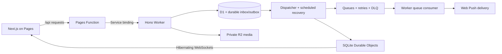

# Behind the builds

A closer look at how I approach data and business systems: the workflow, the failure modes, and the decisions that keep the numbers explainable.

[← Back to my profile](../README.md)

## Cloudflare: real-time delivery with a durable backbone

**Workers · Pages · D1 · R2 · Durable Objects · Queues · Access · Web Push**

The construction platform uses Cloudflare as its application runtime, persistence layer, identity boundary, and delivery infrastructure.

### Delivery survives disconnections and retries

D1-backed notification state records delivery attempts and receipts. Queue messages can retry with backoff; terminal failures have a dead-letter path. Scheduled recovery revisits unfinished work, while leases and replay generations coordinate attempts. Delivery acceptance and display receipts are tracked separately rather than assuming an accepted push was seen.

Live updates use **SQLite Durable Objects with hibernating WebSockets**. Socket attachments preserve device/session context. Automatic ping/pong supports hibernation, and alarms expire sessions. Signals recheck user/device authorization before delivery.

### Identity, media, and cache boundaries

- **Access JWT verification:** validate RS256 signatures against JWKS and check audience, issuer, expiry, and not-before claims. Active status and additive roles come from D1.
- **Same-origin API transport:** a Pages Function forwards requests through an internal Worker service binding, carrying the Access identity boundary into the API.
- **Private media:** Worker-issued HMAC-signed URLs authorize R2 transfers. Authorization runs before cache lookup; immutable media use a stable internal cache identity, keeping URL signatures out of the cache key.
- **Frontend contracts:** shared Zod schemas/types and TanStack Query connect the React interface to the API. IndexedDB preserves offline capture, while review and payment decisions remain online.

These are implemented mechanisms, rather than a claim of exactly-once delivery or unlimited scale. The design makes interrupted work observable and recoverable.

## Construction operations: connecting field evidence to payments

**Next.js · TypeScript · Hono · Cloudflare Workers · D1 · R2**

Construction reporting needs to connect what happened on site with who can approve it, what materials were used, and what a contractor should be paid. The application brings QC, purchasing, stock, project tasks, and contractor payment workflows into one system.

Three decisions matter particularly:

- **Enforce permissions at the API.** Roles are resolved on the server, and shared schemas validate input across the frontend and Worker. The interface reflects permissions; the backend enforces them.
- **Preserve work through connectivity loss.** An IndexedDB queue stores pending submissions and photo blobs for replay. The interface distinguishes a queued entry from a confirmed one.
- **Publish complete accounting snapshots.** The Accurate integration breaks stock synchronization into resumable warehouse steps to fit Worker request limits. Staged stock remains hidden until the final commit, avoiding a half-refreshed inventory view. OAuth tokens are encrypted using AES-GCM with HKDF-derived keys; request pacing and per-invocation budgets bound external API work.

The implementation includes forward database migrations and regression tests for access boundaries, material workflows, stock calculations, and accounting integration. Private client records and deployment details are excluded from this overview.

## Google Workspace: small systems with explicit business rules

**30 standalone portfolio projects · Apps Script · Sheets · Forms · Drive · Docs · Calendar**

The portfolio covers operational applications and data workflows. Examples include CRM reminders, rental billing, nursery inventory and invoicing, rent ledgers, lesson scheduling, food-lot traceability, supplier catalogue normalization, and booking/payment reconciliation.

The value is in the behavior around the spreadsheet:

| System | Business rule or engineering decision |
| :--- | :--- |
| **Wellness CRM** | Customer emails require consent. Reminder deduplication prevents repeat sends, and recurring due dates advance after communication succeeds. |
| **Console rental POS** | Server-authoritative timers feed tiered pricing, promotions, extension charges, and separate loyalty and saved-time balances. Billing rules have a standalone test harness. |
| **Nursery operations** | Sales and losses affect stock; processed-row guards prevent double counting. Quotes and invoices become PDF outputs, while the public catalogue omits internal costs and margins. |
| **Contact cleaning** | Invalid values retain an explanation, and possible duplicate contacts become review candidates instead of being silently merged. |
| **Booking/payment ledger** | Currency conversion requires explicit reference rates; unmapped statuses and missing rates are flagged for review. |
| **Food-lot traceability** | Ingredient lots connect through production batches to affected shipments. Downstream holds and evidence-backed releases follow that genealogy. |
| **Localization release desk** | Source and translation revisions invalidate stale approvals; optimistic revision checks prevent stale writes, and approved content is captured in versioned release snapshots. |
| **Grant delivery controls** | Budget validation includes open commitments, so an apparently available balance cannot ignore already-promised spending. |

Data pipelines freeze run settings, preserve raw inputs, checkpoint collection/processing cursors, and stage results before publishing. Field-level transformation records capture original values, changed values, and applied rules. Ambiguous contacts and inconsistent dates enter review rather than being silently guessed.

Several applications use command journals, resumable work, queued integrations, and repair flows that preserve existing business data. Business settings live in the workbook so routine changes do not require source edits.

**Verification, 17 October 2026:** the local portfolio runner completed **29 project regression suites with zero failures**, alongside its shared portfolio checks. These run actual application source against mocked Google services. They establish local behavior; live OAuth, delivery, rendering, and service quotas require account-specific verification.

### Public example

[Attendee Badge Generator](https://github.com/marzelino10/label-generator) turns sheet records into three physical print formats. Dimensions derive from page size, margins, rows, and columns. Editable settings fall back to validated defaults, and both output paths share the label template.

[Read the source](https://github.com/marzelino10/label-generator/blob/main/Code.gs) · [Inspect the print layout](https://github.com/marzelino10/label-generator/blob/main/labels.html)

## Offline retail: make every sale and stock movement explainable

**Rust · Tauri · SQLite · JavaScript**

This desktop POS is designed for a retailer that must keep selling without internet access. The backend owns money, stock, and authorization; the frontend handles the cashier interaction.

- A cart UUID identifies a sale attempt. Replaying the request returns the original receipt, and a unique database constraint also guards the insert path.
- Prices and costs are read from the database inside the sale transaction. Costs are captured on sale lines so later supplier-price changes do not rewrite historical margins.
- An append-only stock movement ledger explains receipts, transfers, sales, voids, and corrections. Cached stock balances can be rebuilt from that ledger.
- Automatic backups, numbered migrations, and scrubbed support bundles are part of the application’s support workflow.

This is separate from my earlier React POS prototype, which explored keyboard-first checkout, barcode search, and multiple sellable units per product.

## Data engineering: preserve raw inputs and make transformations inspectable

### Global Ski Resorts Pipeline

**AWS S3 · Snowflake · dbt**

Raw source files move through Bronze, Silver, and Gold models. The analytical layer includes weighted resort suitability scoring and a spatial join that associates resorts with snow observations within 30 km. Tests cover identifiers, accepted values, and geographic ranges. The source dataset is a fixed snapshot loaded in batch.

[Scoring model](https://github.com/marzelino10/ski-resorts/blob/main/ski_resorts_pipeline/models/gold/gold_beginner_expert_resort.sql) · [Spatial model](https://github.com/marzelino10/ski-resorts/blob/main/ski_resorts_pipeline/models/gold/gold_resort_snow_coverage.sql) · [Quality checks](https://github.com/marzelino10/ski-resorts/tree/main/ski_resorts_pipeline/tests)

### Disaster Monitor

**Python · Airflow · Docker · GCS · BigQuery · dbt**

The current local implementation supports daily USGS ingestion and parameterized historical backfills, with monthly task mapping for historical work. Incremental models use earthquake IDs for merges, monthly partitions organize the event models, and spatial enrichment associates events with countries. Pipeline and ingestion statistics, retry policies, and Slack callbacks support operational visibility.

The earlier repository implementation used Snowflake; the current local work moves the warehouse and transformations to BigQuery.

## BI: define the decision, then the measure

### Olist Executive Dashboard

**Power BI · Power Query · DAX**

Four pages connect executive performance, sales, operations, and satisfaction. The semantic model contains distinct-order counts, revenue and cancellation measures, delivery buckets, and filter-aware calculations. Dynamic callouts respond to the selected period, state, category, and order status.

This is a self-directed analysis of the public Olist dataset. Its business metrics describe that dataset rather than results delivered to a client.

[Dashboard preview](https://marzelino10.github.io/olist-executive-dashboard/) · [Versioned semantic model](https://github.com/marzelino10/olist-executive-dashboard/tree/main/Olist%20Executive%20Dashboard.SemanticModel/definition)

## Browser Python: execution without a Python server

**React · TypeScript · CodeMirror · Comlink · Pyodide/WebAssembly · pandas · matplotlib**

The learning platform runs Python in a dedicated browser worker, with static files deployed through Cloudflare Workers Static Assets. It avoids a server-side learner-code execution service.

The runtime distinguishes a cold interpreter download/boot from a learner program. Boot has its own budget; learner execution has a five-second deadline. A runaway program terminates the worker, and the next attempt creates a fresh interpreter. Each ordinary run also starts from a fresh Python namespace so prior variables do not silently influence the result.

Outcome-based grading checks the resulting values/DataFrames rather than enforcing one sequence of commands. The lesson checks exercise alternative correct solutions and plausible incorrect answers. Package profiles load analysis dependencies when needed.

The product has an explicit hosting-cost ceiling. Moving computation into the learner’s browser and serving static assets is an architectural response to that constraint; cost models are planning estimates, rather than a claim about measured production bills.

## Interactive products and delivery

| Build | Engineering beyond the interface |
| :--- | :--- |
| **Isometric portfolio** | Native Canvas 2D projection, depth sorting, street routing, playable interiors, and furniture-aware movement. Regression checks exercise waypoint movement, reachability, coordinate round trips, and indoor collisions. |
| **Fishday** | A Kotlin/Compose game with an immutable simulation engine, explicit time inputs, saved RNG state, and offline timers. Its custom renderer implements orthographic projection, flat lighting, back-face/off-screen culling, depth ordering, and reused triangle buffers. |
| **Hanzi Match** | Solvable tile-board generation combines with Leitner vocabulary records, weakest-word selection, daily review selection, Simplified/Traditional content, device pronunciation, and stroke-order data. Current development targets are Android and desktop. |
| **Photography portfolio** | Astro/React and local Keystatic editing, plus Sharp-generated AVIF/WebP images in four sizes. Build validation covers generated links, metadata, JSON-LD, image alt text, and deployment bounds. |
| **Windows POS packaging** | Linux-based Rust cross-compilation with cargo-xwin, NSIS installer and portable executable generation, checksums, numbered migrations, installation instructions, and a support runbook. |
| **Invitation studio** | A local-first vinext/React application with D1 and Drizzle, guest passcode gates, RSVP upserts, bounded result sets, and redacted payloads before unlock. |

### Applied semantic search

[Moody Quotes](https://github.com/marzelino10/moody-quotes) collects quotes, stores them through PostgreSQL/Supabase, and uses Sentence Transformers embeddings with cosine similarity in Streamlit. Model and embedding caches avoid recomputing the corpus on every search.

[Inspect the matching implementation](https://github.com/marzelino10/moody-quotes/blob/main/app.py) · [Inspect collection and storage](https://github.com/marzelino10/moody-quotes/blob/main/scraper.py)

A separate local document-Q&A experiment uses PDF chunking, Ollama embeddings, LangChain, and Chroma retrieval to supply context to a local model.

---

**The common thread:** model the process, keep the business rules explicit, and make failures and corrections understandable.
